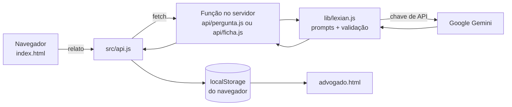

# LEXIAN — Assistente Jurídico com Inteligência Artificial

Protótipo de **triagem inicial de relatos jurídicos** feito para o Projeto Integrador.

**Integrantes:** Chrislley Emylly de Oliveira Vilela, Liana Raquel Silva dos Santos Costa e Lucas Samuel Alves Ribeiro.

**Endereço do protótipo no ar:** _(preencher depois do deploy)_

> **Aviso:** este é um protótipo acadêmico. Use **apenas casos fictícios**. Não digite dados reais de ninguém (CPF, senhas, dados bancários, relatos de casos verdadeiros).

---

## 1. O que é

Quem procura um advogado costuma contar o caso de forma bagunçada: faltam datas, nomes e documentos. A LEXIAN conversa com a pessoa, pede o relato e transforma tudo numa **ficha organizada** para o advogado.

A LEXIAN **não** dá parecer jurídico, **não** diz se a pessoa tem direito e **não** substitui um advogado. Ela só organiza as informações.

## 2. Como funciona (visão rápida)

O sistema tem **dois lados**, com telas separadas:

| Tela | Arquivo | Quem usa | O que faz |
|---|---|---|---|
| Triagem | `index.html` | O cliente | Conversa em etapas e termina com uma mensagem de agradecimento. **Nunca** vê a ficha, a área nem a urgência |
| Painel do advogado | `advogado.html` | O advogado | Lista os casos (urgência alta primeiro) e mostra a ficha completa |
| Projeto | `projeto.html` | A equipe | Modelo de testes com usuários e registro dos prompts (material do trabalho, não do produto) |

### A conversa com o cliente

1. A Lexian pergunta o **nome**.
2. Pede o **relato**, com as palavras do cliente.
3. A IA lê o relato e faz **uma única pergunta** sobre o que mais falta (datas, pessoas ou documentos).
4. O cliente responde.
5. A IA monta a **ficha** e o sistema a salva.
6. O cliente recebe a mensagem de agradecimento.

A área do direito e a urgência ficam **só no painel do advogado**, para o cliente não ler um diagnóstico automático.

### O que tem na ficha

Nome, área do direito, urgência e o motivo dela, resumo, fatos, partes, datas, documentos citados, pedido do cliente e informações faltantes. O relato original e a resposta do cliente também aparecem no painel.

## 3. Onde a IA entra

A IA faz **só duas tarefas**, cada uma com um prompt:

1. **Pergunta de acompanhamento (Prompt 2):** recebe o relato e devolve uma pergunta curta.
2. **Ficha de triagem (Prompt 1):** recebe a data de hoje, o nome, o relato e a resposta, e devolve um JSON com os campos da ficha.

O nome, o relato, a pergunta, a resposta e a data de criação **não vêm da IA**: o sistema junta esses campos depois.

### O caminho dos dados



**Por que existe um servidor no meio?** Se o navegador falasse direto com a IA, a **chave de API** ficaria visível para qualquer pessoa. Por isso a chave vive só no servidor.

## 4. Estrutura de pastas

```
lexian/
  index.html          Tela do cliente
  advogado.html       Painel do advogado
  projeto.html        Testes e engenharia de prompts
  package.json
  .gitignore
  servidor-local.js   Servidor para testar no computador
  css/                Estilos (styles.css e tailwind-config.js)
  src/                Arquivos que rodam no NAVEGADOR
    common.js           Funções comuns (escapeHtml, localStorage)
    api.js              Conversa com o servidor (fetch)
    scripts/            Lógica de cada tela
  api/                Funções do SERVIDOR (cada arquivo vira um endereço)
    pergunta.js         POST /api/pergunta
    ficha.js            POST /api/ficha
  lib/                Código do SERVIDOR usado pelas funções
    lexian.js           Prompts, chamada à IA, validação do JSON
```

Regra de ouro: o que está em `src/` o navegador baixa e **qualquer um pode ler**. Prompts e chave ficam em `lib/` e nas variáveis de ambiente.

## 5. O que o servidor faz além de repassar

- **Limita o tamanho** do texto recebido.
- **Garante o formato:** se a IA devolver o JSON dentro de blocos de código ou com texto extra, o servidor limpa. Área e urgência só podem ter os valores permitidos (qualquer outro vira `indeterminada` ou `media`).
- **Plano B de modelos:** se o modelo principal falhar (por exemplo, erro 503 por excesso de demanda), tenta o modelo reserva e depois tenta de novo.
- **Limite de tempo:** se a IA não responder em 15 segundos, desiste dessa tentativa.
- **Se tudo falhar:** o chat não trava. A pergunta vira uma pergunta genérica e a ficha sai como `indeterminada` com o aviso "Revisar manualmente".

> Atenção ao testar: uma ficha "indeterminada" com "Revisar manualmente" num caso claramente jurídico significa que a IA **falhou**. Não conte como acerto nem como erro da IA. Refaça o teste.

## 6. Prompts (engenharia de prompts)

Os prompts ficam em `lib/lexian.js`. Cada mudança vira uma versão nova, e o resultado de cada teste deve ser anotado em `projeto.html`.

| Versão | O que mudou |
|---|---|
| **Prompt 2 v1** | Pergunta de acompanhamento: uma única pergunta curta, sem opinião jurídica |
| **Prompt 1 v1** | Classificação em JSON, a partir de nome e relato (do documento do laboratório) |
| **Prompt 1 v2** | Passou a receber também a resposta do cliente à pergunta |
| **Prompt 1 v3** | Regra contra parecer no motivo da urgência e data de hoje na entrada (a IA dizia que "o prazo legal se esgotou" e errava o tempo decorrido) |
| **Prompt 1 v4** | Regras de fidelidade: usar as palavras do cliente, manter valores aproximados, não completar datas incompletas, incluir valores nos fatos, não colocar a data de hoje em "datas" e listar melhor as informações faltantes |

Defeitos encontrados nos testes internos e o que cada um gerou:

- Parecer jurídico no motivo da urgência (v2 → corrigido na v3).
- Termo jurídico que o cliente não usou, como "vício de qualidade" (v3 → v4).
- Valor pago omitido na ficha (v3 → v4).
- "Ajuda" de 600 reais virou "pensão" de 600 reais (v3 → v4).
- Frase solta onde deveria estar "não informado" (v3 → v4).

## 7. Segurança e privacidade

- A **chave de API não está no código**. Ela fica em variáveis de ambiente (`.env` no computador, painel da Vercel no ar). O `.env` está no `.gitignore` e **nunca** deve ser enviado ao GitHub.
- Todo texto que entra na tela passa por `escapeHtml`, para impedir que alguém injete código.
- O prompt manda ignorar instruções escondidas dentro do relato e não registrar CPF, senhas nem dados bancários.
- O plano gratuito do Google pode usar o que for enviado à IA. Por isso, **só casos fictícios**.

## 8. Como rodar no computador

Precisa do **Node.js** (versão LTS) instalado.

1. Na pasta do projeto, instale as dependências:
   ```
   npm install
   ```
2. Crie um arquivo `.env` na raiz (sem aspas e sem espaços):
   ```
   GEMINI_API_KEY=sua_chave
   GEMINI_MODEL=codigo_do_modelo
   GEMINI_MODEL_RESERVA=codigo_do_modelo_reserva
   PORT=3000
   ```
   A chave é criada no Google AI Studio. O código do modelo é copiado do seletor de modelos de lá.
3. Rode o servidor:
   ```
   node servidor-local.js
   ```
4. Abra `http://localhost:3000` no navegador. O painel do advogado é `http://localhost:3000/advogado.html`.

Se mudar o `.env`, pare o servidor (Ctrl+C) e rode de novo.

## 9. Como publicar (GitHub + Vercel)

1. Suba o projeto para um repositório no GitHub. Antes do commit, rode `git status` e confirme que o `.env` e a pasta `node_modules` **não** aparecem na lista.
2. Na Vercel, importe o repositório e escolha o **Framework Preset: Other**.
3. Em **Environment Variables**, cadastre `GEMINI_API_KEY`, `GEMINI_MODEL` e `GEMINI_MODEL_RESERVA`.
4. Clique em **Deploy**. Se mudar uma variável depois, faça um novo deploy (Redeploy).

Na Vercel, cada arquivo da pasta `api/` vira um endereço do servidor. Por isso a pasta `api/` só pode ter funções do servidor. Os arquivos do navegador ficam em `src/`.

## 10. Limitações conhecidas

- O painel do advogado lê os casos do **`localStorage`**, então só enxerga o que foi enviado **no mesmo navegador**. Para a demonstração serve. Um sistema real usaria banco de dados.
- O relato original e a resposta aparecem **inteiros** no painel, sem filtro. Se o cliente digitar CPF ou senha, isso aparece ali. Uma melhoria futura é mascarar esses dados antes de enviar à IA e antes de salvar.
- O serviço gratuito do Google pode ficar instável (erro 503) ou lento em horários de pico. Há modelo reserva, mas pode haver demora.
- Com o site público, a cota gratuita da chave pode ser gasta por qualquer pessoa que tenha o link.
- A IA pode errar. A classificação de área e a urgência são **preliminares** e precisam de revisão de um advogado. A amostra de testes é pequena demais para provar a precisão geral da IA.
- Esta versão **não** inclui pagamentos, banco de dados, login, integração com PJe ou e-SAJ, nem geração de petições.

## 11. Aviso exibido na tela do cliente

> Este é um assistente virtual automatizado para triagem de fatos. Ele não fornece consultoria jurídica. Suas respostas serão analisadas por advogados humanos.

## 12. Modelo de negócio (visão do projeto)

SaaS por assinatura mensal para advogados autônomos, escritórios pequenos e médios e departamentos jurídicos. A expansão dependeria da adoção por escritórios e da inclusão de novas áreas do direito.

---

## Quem mexe em quê (guia rápido para a equipe)

| Quero mudar... | Edite... |
|---|---|
| Textos e aparência do chat | `index.html`, `css/`, `src/scripts/` |
| Aparência do painel do advogado | `advogado.html` e o script dele em `src/scripts/` |
| O comportamento da IA (prompts) | `lib/lexian.js` (e anote a nova versão em `projeto.html`) |
| Modelo de IA usado | variável `GEMINI_MODEL` (`.env` ou Vercel) |
| Como o navegador chama o servidor | `src/api.js` |
| Regras de validação da ficha | `lib/lexian.js` |

**Nunca** mexa na pasta `api/` colocando arquivos do navegador, e **nunca** envie o `.env` ao GitHub.