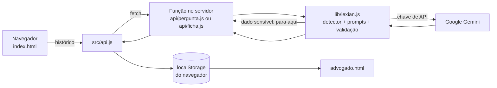

# LEXIAN — Assistente Jurídico com Inteligência Artificial

Protótipo de **triagem inicial de relatos jurídicos** feito para o Projeto Integrador.

**Integrantes:** Chrislley Emylly de Oliveira Vilela, Liana Raquel Silva dos Santos Costa e Lucas Samuel Alves Ribeiro.

**Endereço do protótipo no ar:** _(preencher depois do deploy)_

> **Aviso:** este é um protótipo acadêmico. Use **apenas casos fictícios**. Não digite dados reais de ninguém (CPF, senhas, dados bancários, relatos de casos verdadeiros).

---

## 1. O que é

Quem procura um advogado costuma contar o caso de forma bagunçada: faltam datas, nomes e documentos. A LEXIAN conversa com a pessoa, faz as perguntas que faltam e transforma tudo numa **ficha organizada** para o advogado.

A LEXIAN **não** dá parecer jurídico, **não** diz se a pessoa tem direito e **não** substitui um advogado. Ela só organiza as informações.

Além disso, o chat tem duas proteções:

- **Só assuntos jurídicos:** mensagens fora do tema recebem uma recusa fixa e não geram triagem.
- **Sem dados sensíveis:** mensagens com CPF, senha, dados de cartão ou bancários são barradas pelo servidor, não chegam à IA e não são salvas. A própria IA também é proibida de pedir esse tipo de dado.

## 2. Como funciona (visão rápida)

O sistema tem **dois lados**, com telas separadas:

| Tela | Arquivo | Quem usa | O que faz |
|---|---|---|---|
| Triagem | `index.html` | O cliente | Conversa com a Lexian e termina com uma mensagem de agradecimento. **Nunca** vê a ficha, a área nem a urgência |
| Painel do advogado | `advogado.html` | O advogado | Lista os casos (urgência alta primeiro) e mostra a ficha completa e a conversa |
| Projeto | `projeto.html` | A equipe | Modelo de testes com usuários e registro dos prompts (material do trabalho, não do produto) |

### A conversa com o cliente

O chat tem três etapas: `nome` → `conversa` → `fim`.

1. A Lexian pergunta o **nome**. O navegador não aceita nomes com números.
2. O cliente conta o **relato**, com as palavras dele.
3. A cada mensagem, o navegador envia o **histórico inteiro** para o servidor, e a IA decide o próximo passo:
   - `pergunta`: faz **uma** pergunta curta sobre o que ainda falta;
   - `completo`: a conversa tem informação suficiente;
   - `fora_do_escopo`: a última mensagem não tem relação com um problema jurídico.
4. O servidor ainda pode responder `dado_sensivel`, quando detecta um dado sensível (isso é decidido pelo código, não pela IA).
5. Quando o status é `completo`, a IA monta a **ficha** com a conversa inteira e o sistema a salva.
6. O cliente recebe a mensagem final e o chat é encerrado.

**Quantas perguntas?** A IA decide quando o caso está completo, com duas travas:

- **Mínimo de 3 perguntas** antes de encerrar. Se a IA tenta encerrar cedo demais, o servidor faz uma segunda chamada pedindo para continuar perguntando (a menos que o cliente diga claramente que não tem mais nada a acrescentar).
- **Máximo de 8 perguntas.** Ao atingir o limite, o servidor encerra sozinho, para a conversa não ficar infinita.

**Quando o caso é "completo"?** Quando já constam na conversa (ou o cliente disse que não sabe ou não tem): nome da empresa ou pessoa envolvida, data ou período exato, valores, documentos ou provas, detalhes do ponto central do caso e o que o cliente deseja.

**Perguntas sobre direitos** ("tenho direito a receber?", "posso processar?") **nunca** são respondidas. A IA diz que quem analisa isso é o advogado e que a dúvida fica registrada, e segue com a próxima pergunta.

**Mensagem fora do tema ou com dado sensível:** a mensagem é removida do histórico e da tela, nada é enviado ao advogado e o cliente pode continuar a conversa normalmente.

A área do direito e a urgência ficam **só no painel do advogado**, para o cliente não ler um diagnóstico automático.

### O que tem na ficha

Nome, área do direito, urgência e o motivo dela, resumo, fatos, partes, datas, documentos citados, pedido do cliente e informações faltantes. Cada caso salvo guarda também a **conversa completa** (campo `conversa`), e o painel mostra o relato e as respostas do cliente.

## 3. Onde a IA entra

A IA faz **só duas tarefas**, cada uma com um prompt, e ambas ficam em `lib/lexian.js`:

1. **Próximo passo da conversa (`proximoPassoIA`):** recebe o histórico e devolve um JSON `{status, mensagem}`, com status `pergunta`, `completo` ou `fora_do_escopo`.
2. **Ficha de triagem (`fichaIA`):** recebe a data de hoje, o nome e a conversa completa, e devolve um JSON com os campos da ficha.

O nome, a conversa e a data de criação **não vêm da IA**: o sistema junta esses campos depois.

As mensagens de recusa (fora do tema) e de aviso (dado sensível) são **textos fixos do código**. A IA decide só o status; o texto mostrado ao cliente nesses casos nunca é gerado por ela.

### O caminho dos dados



**Por que existe um servidor no meio?** Se o navegador falasse direto com a IA, a **chave de API** ficaria visível para qualquer pessoa. Por isso a chave vive só no servidor.

### O que cada rota devolve

| Rota | Recebe | Devolve |
|---|---|---|
| `POST /api/pergunta` | `{ historico }` | `{ status, mensagem }`, com status `pergunta`, `completo`, `fora_do_escopo` ou `dado_sensivel` |
| `POST /api/ficha` | `{ nome, historico }` | `{ ficha, enviavel, motivo }` |

`enviavel` é `false` quando a ficha sai com área `indeterminada` (nada jurídico identificado, dado sensível ou falha da IA). Nesse caso **nada é salvo**, e `motivo` diz se o aviso a mostrar é o de dado sensível ou o de fora do escopo.

O `historico` é uma lista de `{ papel: "cliente" | "lexian", texto }`.

## 4. Estrutura de pastas

```
lexian/
  index.html          Tela do cliente
  advogado.html       Painel do advogado
  projeto.html        Testes e engenharia de prompts
  package.json
  .gitignore
  servidor-local.js   Servidor para testar no computador
  css/                Estilos (styles.css e tailwind-config.js)
  src/                Arquivos que rodam no NAVEGADOR
    common.js           Funções comuns (escapeHtml, normalizarCaso, localStorage)
    api.js              Conversa com o servidor (fetch)
    scripts/            Lógica de cada tela (clientes.js, advogado.js)
  api/                Funções do SERVIDOR (cada arquivo vira um endereço)
    pergunta.js         POST /api/pergunta
    ficha.js            POST /api/ficha
  lib/                Código do SERVIDOR usado pelas funções
    lexian.js           Prompts, detector de dados sensíveis, chamada à IA, validação
```

Regra de ouro: o que está em `src/` o navegador baixa e **qualquer um pode ler**. Prompts e chave ficam em `lib/` e nas variáveis de ambiente.

## 5. O que o servidor faz além de repassar

- **Valida o histórico** (`limparHistorico`), porque ele vem do navegador e pode ser forjado: no máximo 30 mensagens, 4.000 caracteres por mensagem e 20.000 no total, sem mensagens vazias. O corpo da requisição também é limitado a 100 KB.
- **Barra dados sensíveis antes da IA** (veja a seção 7). A mensagem barrada nunca chega ao Gemini.
- **Controla o fim da conversa:** aplica o mínimo de 3 e o máximo de 8 perguntas.
- **Garante o formato:** se a IA devolver o JSON dentro de blocos de código ou com texto extra, o servidor limpa. Área e urgência só podem ter os valores permitidos (qualquer outro vira `indeterminada` ou `media`).
- **Descarta respostas inválidas da IA:** status desconhecido, pergunta vazia ou texto com dado sensível geram uma nova tentativa.
- **Plano B de modelos:** se o modelo principal falhar (por exemplo, erro 503 por excesso de demanda), tenta o modelo reserva e depois tenta de novo.
- **Limite de tempo:** se a IA não responder em 15 segundos, desiste dessa tentativa.
- **Se tudo falhar:**
  - na conversa, o servidor responde erro 500 e o chat mostra "ocorreu um erro, envie sua mensagem novamente" (a mensagem volta para o campo de texto);
  - na ficha, ela sai como `indeterminada`, não é considerada enviável e nada é salvo.

> Atenção ao testar: se um caso claramente jurídico cair no aviso de "fora do escopo", a IA pode ter **falhado**, ou o servidor antigo ainda está rodando. Não conte como acerto nem como erro da IA. Reinicie o servidor e refaça o teste. No terminal, a linha `-> Chamando o Gemini` mostra se a mensagem chegou à IA.

## 6. Prompts (engenharia de prompts)

Os prompts ficam em `lib/lexian.js`. Cada mudança vira uma versão nova, e o resultado de cada teste deve ser anotado em `projeto.html`.

Existem dois prompts: o de **ficha** (Prompt 1) e o de **triagem da conversa**, que substituiu o antigo Prompt 2 (pergunta única).

| Versão | O que mudou |
|---|---|
| **Prompt 2 v1** | Pergunta de acompanhamento: uma única pergunta curta, sem opinião jurídica (substituído pelo prompt de triagem) |
| **Prompt 1 v1** | Classificação em JSON, a partir de nome e relato (do documento do laboratório) |
| **Prompt 1 v2** | Passou a receber também a resposta do cliente à pergunta |
| **Prompt 1 v3** | Regra contra parecer no motivo da urgência e data de hoje na entrada (a IA dizia que "o prazo legal se esgotou" e errava o tempo decorrido) |
| **Prompt 1 v4** | Regras de fidelidade: usar as palavras do cliente, manter valores aproximados, não completar datas incompletas, incluir valores nos fatos, não colocar a data de hoje em "datas" e listar melhor as informações faltantes |
| **Prompt 1 v5** | Passou a receber a **conversa inteira** em vez de relato e resposta; regra de não pedir nem registrar CPF, RG, senhas, dados de cartão ou bancários |
| **Triagem v1** | Substitui o Prompt 2: devolve JSON com status `pergunta`, `completo` ou `fora_do_escopo`; a IA decide quando encerrar; bloqueio de assuntos fora do tema |
| **Triagem v2** | Critérios para considerar o caso "completo" (empresa ou pessoa, datas exatas, valores, documentos, detalhes do ponto central, pedido do cliente) e regra de que perguntas sobre direitos nunca são respondidas |
| **Triagem v3** | Regras 7 e 8: a IA nunca pede dado sensível (para documentos, só pergunta *se* o cliente os tem) e não repete nem registra o que o cliente informar |

> Ajuste a numeração das versões de triagem para ficar igual à que está em `projeto.html`.

Defeitos encontrados nos testes internos e o que cada um gerou:

- Parecer jurídico no motivo da urgência (Prompt 1 v2 → corrigido na v3).
- Termo jurídico que o cliente não usou, como "vício de qualidade" (v3 → v4).
- Valor pago omitido na ficha (v3 → v4).
- "Ajuda" de 600 reais virou "pensão" de 600 reais (v3 → v4).
- Frase solta onde deveria estar "não informado" (v3 → v4).
- Num caso trabalhista, a IA encerrou cedo e ignorou a dúvida "tenho direito a receber?" (→ critérios de "completo" e regra de não responder sobre direitos).
- O texto literal `${MIN}` era enviado à IA em vez do número mínimo de perguntas (→ corrigido para `MIN_PERGUNTAS`).
- O aviso de "fora do escopo" aparecia para uma mensagem com dado sensível; a causa era o servidor antigo rodando sem reinício, e a rota da ficha passou a informar o `motivo`.

## 7. Segurança e privacidade

- A **chave de API não está no código**. Ela fica em variáveis de ambiente (`.env` no computador, painel da Vercel no ar). O `.env` está no `.gitignore` e **nunca** deve ser enviado ao GitHub.
- Todo texto que entra na tela passa por `escapeHtml`, para impedir que alguém injete código.
- O prompt manda ignorar instruções escondidas dentro do relato.
- O plano gratuito do Google pode usar o que for enviado à IA. Por isso, **só casos fictícios**.

### Proteção contra dados sensíveis

Há três camadas, da mais forte para a mais fraca:

1. **Detector no servidor (`detectarDadoSensivel` em `lib/lexian.js`).** É um conjunto de regras (regex) que roda **antes** de qualquer chamada à IA. Se achar algo, o servidor responde `dado_sensivel` com um aviso fixo, o navegador apaga a mensagem da tela e do histórico, e nada é enviado ao Gemini nem salvo. Como é código, não depende de a IA obedecer e não gasta cota. O detector é repetido na geração da ficha (incluindo o nome), como segunda barreira.
2. **Prompts.** A IA é proibida de pedir CPF, RG, senhas, códigos de verificação e dados de cartão ou bancários (para documentos, só pergunta *se* o cliente os tem). Se o cliente mencionar algum mesmo assim, ela não repete nem registra. Se o texto gerado pela IA parecer conter dado sensível, o servidor o descarta e tenta de novo.
3. **Navegador.** O campo do nome não aceita números. Isso é só conforto de uso: quem manda de verdade é o servidor.

**O que o detector reconhece:**

| Tipo | Como é reconhecido |
|---|---|
| CPF | Formatado (`000.000.000-00`), ou com a palavra "CPF" por perto, ou 11 dígitos com dígitos verificadores válidos |
| RG | A palavra "RG" ou "identidade" seguida de número |
| Cartão | 13 a 19 dígitos (com espaços ou hífens) que passam no teste de Luhn, e CVV/CVC |
| Dados bancários | Agência, conta com 5 ou mais dígitos, chave Pix com e-mail, telefone ou código aleatório, IBAN |
| Senhas e códigos | "senha", "PIN" ou "token" seguidos de `:`, `=` ou "é" e um valor; código de verificação, segurança ou acesso com número |

**O que ele deixa passar de propósito:** números de processo e de protocolo (a ficha pede esses dados), valores em reais, "esqueci minha senha", CNPJ, e-mail e telefone (dados de contato comuns).

**O que ele ainda não cobre:** CNH, título de eleitor, passaporte, endereço completo, senha dita de forma solta (sem "senha:" ou "é") e dados escritos por extenso ou com separadores incomuns. Esses casos chegam à IA, e só o prompt protege. Para incluir um tipo novo, acrescente um padrão em `PADROES_SENSIVEIS` e teste com frases fictícias.

**Falsos positivos aceitos:** frases como "a senha é complicada" podem ser barradas. O cliente só precisa reescrever a mensagem.

## 8. Como rodar no computador

Precisa do **Node.js** (versão LTS) instalado.

1. Na pasta do projeto, instale as dependências:
   ```
   npm install
   ```
2. Crie um arquivo `.env` na raiz (sem aspas e sem espaços):
   ```
   GEMINI_API_KEY=sua_chave
   GEMINI_MODEL=codigo_do_modelo
   GEMINI_MODEL_RESERVA=codigo_do_modelo_reserva
   PORT=3000
   ```
   A chave é criada no Google AI Studio. O código do modelo é copiado do seletor de modelos de lá.
3. Rode o servidor:
   ```
   node servidor-local.js
   ```
4. Abra `http://localhost:3000` no navegador. O painel do advogado é `http://localhost:3000/advogado.html`.

**Sempre que mudar o `.env` ou qualquer arquivo do servidor** (`lib/`, `api/`, `servidor-local.js`), pare o servidor (Ctrl+C) e rode de novo. O Node só carrega esses arquivos ao iniciar. Para mudanças no navegador (`src/`, HTML, CSS), recarregue a página com Ctrl+F5.

## 9. Como publicar (GitHub + Vercel)

1. Suba o projeto para um repositório no GitHub. Antes do commit, rode `git status` e confirme que o `.env` e a pasta `node_modules` **não** aparecem na lista.
2. Na Vercel, importe o repositório e escolha o **Framework Preset: Other**.
3. Em **Environment Variables**, cadastre `GEMINI_API_KEY`, `GEMINI_MODEL` e `GEMINI_MODEL_RESERVA`.
4. Clique em **Deploy**. Se mudar uma variável depois, faça um novo deploy (Redeploy).

Na Vercel, cada arquivo da pasta `api/` vira um endereço do servidor. Por isso a pasta `api/` só pode ter funções do servidor. Os arquivos do navegador ficam em `src/`.

## 10. Roteiro de testes (somente casos fictícios)

| Teste | Resultado esperado |
|---|---|
| Nome com número (`Maria 123`) | Pede só o nome |
| Mensagem fora do tema (receita, programação) | Recusa fixa; a mensagem some do histórico; nada é salvo |
| `meu cpf é 529.982.247-25` | Aviso de dado sensível; a bolha some da tela |
| `cartão 4111 1111 1111 1111` | Aviso de dado sensível |
| `agência 1234 conta 56789-0` | Aviso de dado sensível |
| `a senha é abc123` | Aviso de dado sensível |
| Relato normal com número de processo (`0001234-56.2024.5.07.0001`) | **Não** bloqueia |
| Reenviar o relato sem o dado depois de um bloqueio | A conversa segue normalmente |
| Perguntar "tenho direito a receber?" | A IA não responde; diz que o advogado analisa e segue perguntando |
| Dizer "não tenho mais nada a acrescentar" cedo demais | Aceita encerrar |
| Conversa que passa de 8 perguntas | O servidor encerra sozinho |
| Derrubar a internet ou usar chave inválida | O chat não trava e mostra a mensagem de erro |
| Observar as perguntas da IA | Ela nunca pede CPF, senha ou dados bancários; só pergunta se o cliente tem documentos |

## 11. Limitações conhecidas

- O painel do advogado lê os casos do **`localStorage`**, então só enxerga o que foi enviado **no mesmo navegador e no mesmo endereço** (por exemplo, `localhost:3000`). Para a demonstração serve. Um sistema real usaria banco de dados.
- A conversa inteira aparece no painel, sem filtro. O detector barra os dados sensíveis que reconhece, mas o que ele não cobre (veja a seção 7) pode chegar à IA e aparecer ali.
- O detector funciona por padrões e pode ter falsos positivos e falsos negativos. Ele não substitui o cuidado de usar só casos fictícios.
- O servidor não registra o conteúdo das mensagens em log, mas a mensagem sensível barrada **chega ao servidor** (e não ao Gemini). Evite colocar `console.log` do corpo da requisição.
- O serviço gratuito do Google pode ficar instável (erro 503) ou lento em horários de pico. Há modelo reserva, mas pode haver demora.
- Com o site público, a cota gratuita da chave pode ser gasta por qualquer pessoa que tenha o link.
- A IA pode errar, inclusive ao decidir se o caso está completo ou se um assunto é jurídico. A classificação de área e a urgência são **preliminares** e precisam de revisão de um advogado. A amostra de testes é pequena demais para provar a precisão geral da IA.
- As mensagens fixas de recusa e de aviso existem em dois lugares (`lib/lexian.js` e `clientes.js`). Se mudar uma, mude a outra.
- Esta versão **não** inclui pagamentos, banco de dados, login, integração com PJe ou e-SAJ, nem geração de petições.

## 12. Avisos exibidos na tela do cliente

Aviso geral do assistente:

> Este é um assistente virtual automatizado para triagem de fatos. Ele não fornece consultoria jurídica. Suas respostas serão analisadas por advogados humanos.

Recusa de assunto fora do tema (texto fixo):

> Desculpe, mas este chat é exclusivo para a triagem de casos jurídicos e não posso ajudar com esse assunto. Se tiver dúvidas sobre o funcionamento do atendimento, consulte o nosso FAQ. Se quiser relatar um caso jurídico, é só me contar o que aconteceu.

Aviso de dado sensível (texto fixo):

> Por segurança, não é permitido informar dados sensíveis neste chat, como CPF, RG, senhas, códigos de verificação, dados de cartão ou dados bancários (agência, conta, chave Pix). Sua mensagem não foi registrada. Pode reenviar o relato sem esses dados? Se for necessário, o advogado pedirá essas informações pelos canais oficiais do escritório.

## 13. Modelo de negócio (visão do projeto)

SaaS por assinatura mensal para advogados autônomos, escritórios pequenos e médios e departamentos jurídicos. A expansão dependeria da adoção por escritórios e da inclusão de novas áreas do direito.

---

## Quem mexe em quê (guia rápido para a equipe)

| Quero mudar... | Edite... |
|---|---|
| Textos e aparência do chat | `index.html`, `css/`, `src/scripts/` |
| Aparência do painel do advogado | `advogado.html` e o script dele em `src/scripts/` |
| O comportamento da IA (prompts) | `lib/lexian.js` (e anote a nova versão em `projeto.html`) |
| Mínimo e máximo de perguntas | `MIN_PERGUNTAS` e `MAX_PERGUNTAS` em `lib/lexian.js` |
| O que conta como dado sensível | `PADROES_SENSIVEIS` em `lib/lexian.js` |
| Mensagens de recusa e de aviso | `lib/lexian.js` **e** `src/scripts/clientes.js` (mantenha iguais) |
| Modelo de IA usado | variável `GEMINI_MODEL` (`.env` ou Vercel) |
| Como o navegador chama o servidor | `src/api.js` |
| Regras de validação da ficha e do histórico | `lib/lexian.js` |

**Nunca** mexa na pasta `api/` colocando arquivos do navegador, e **nunca** envie o `.env` ao GitHub.